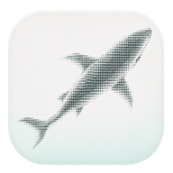
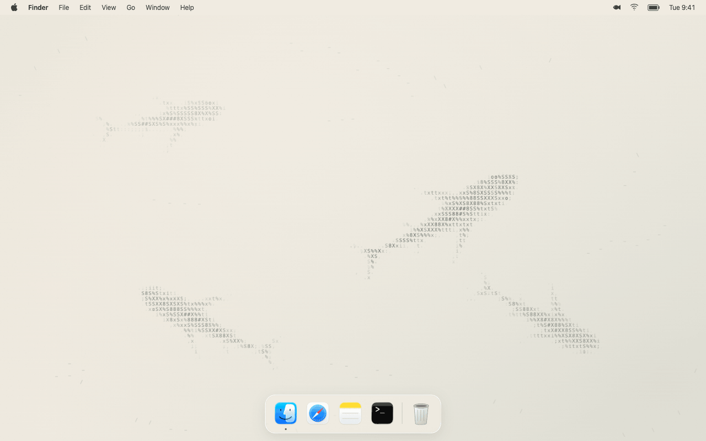
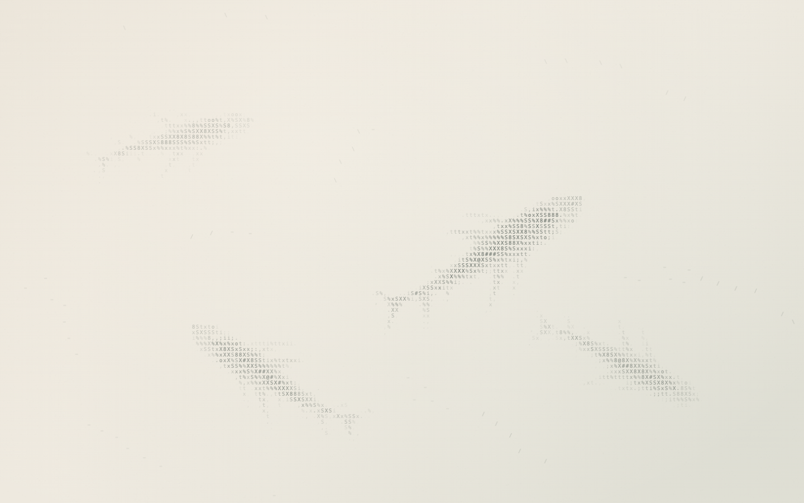
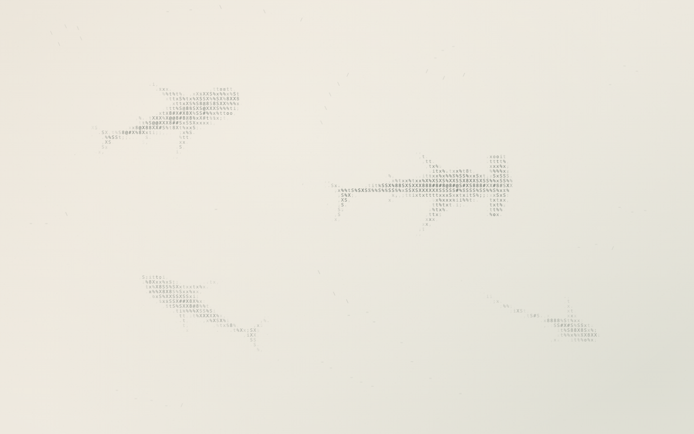
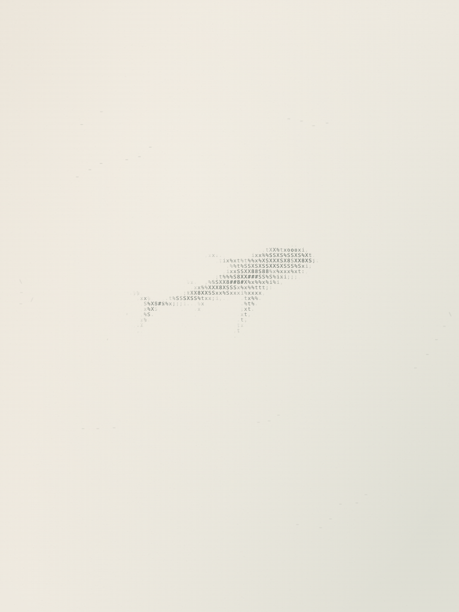

<p align="center">
  
</p>

<h1 align="center">ASCII Sharks Wallpaper</h1>

<p align="center">
  <strong>A quiet ocean, drawn in characters.</strong><br>
  An animated macOS wallpaper with ink-like ASCII sharks, warm paper, and room to breathe.
</p>

<p align="center">
  
</p>

<p align="center">
  <strong>English</strong> · <a href="README.zh-CN.md">简体中文</a>
</p>

<p align="center">
  <a href="https://github.com/s1egg/ascii-sharks-wallpaper/releases/latest"><strong>Download for Mac</strong></a> ·
  <a href="#get-started">Installation</a> ·
  <a href="#scenes">Scenes</a> ·
  <a href="#development">Development</a> ·
  <a href="#faq">FAQ</a>
</p>



<p align="center"><sub>A ten-second Remotion desktop demo using the app's actual renderer; the desktop UI is illustrative. Every shark, fish, and wake is drawn with characters. <a href="docs/assets/macos-desktop.mp4">Watch the video</a> · <a href="docs/assets/scene-classic.png">View a still image</a>.</sub></p>

<p align="center">Free and open source · No accounts · No tracking<br>
Enjoy this little ocean? <a href="https://github.com/s1egg/ascii-sharks-wallpaper">Give it a star</a> or share your ideas in <a href="https://github.com/s1egg/ascii-sharks-wallpaper/issues">Issues</a>.</p>

<a name="features"></a>

## Made for a quieter desktop

Inspired by the spacing and tonal restraint of Chinese ink painting, ASCII Sharks Wallpaper turns a small ocean simulation into a calm desktop background. Sharks glide across a warm paper surface; schools of fish gather, scatter, and find their way back.

Adapted from [stackedlol/ascii-sharks](https://github.com/stackedlol/ascii-sharks), this version adds ink-wash rendering, stroke-and-glide motion, and native macOS desktop integration.

- **Characters with depth.** Glyph density, ink opacity, and soft transitions shape each silhouette. The animals are rendered live in Canvas.
- **Unhurried movement.** Stable heads, articulated tails, gradual turns, and independent stroke-and-glide rhythms.
- **Different swimming habits.** In Mixed, hammerheads patrol horizontally, makos occasionally make a short burst, and threshers turn with a slower tail rhythm.
- **Something to notice.** Occasionally, an existing small school passes through the open water or one pale, uncommon shark swims by in the distance. Moments stay sparse and pause with the scene.
- **Room to breathe.** Sparse small fish travel in loose groups of at most seven, with soft ink and generous spacing. The sharks remain the focus; fish near the pointer become a little clearer.
- **A little curiosity.** Move the pointer to part nearby schools; character ripples appear only when it touches small fish, leaving empty water quiet. Linger for about 0.6 seconds near a passing shark and one may turn and briefly accelerate toward you, easing down as it approaches. Gentle Mouse Interaction is on by default and can be switched off in the menu.
- **A native place on your Mac.** A Swift menu bar app with wallpaper windows behind desktop icons. Clicks pass through, and keyboard focus stays with your work.
- **Considerate animation.** Pause and hide stop animation scheduling. Low Power Mode or serious thermal pressure caps rendering at 15 FPS and lowers resolution. Reduce Motion keeps the scene still.
- **Your preferred pace.** Three scenes, three frame-rate limits, three swim speeds, and a choice of all displays or the primary display. Preferences persist between launches.
- **Your preferred language.** English by default, with an instant switch to Simplified Chinese. Language changes preserve the animation and your saved preferences.
- **Entirely local.** Bundled artwork, system fonts, and a local WKWebView. No accounts, analytics, network requests, or runtime package downloads.

<a name="scenes"></a>

## Three ways to drift

<table>
  <tr>
    <td width="33%" align="center">
      <a href="docs/assets/scene-classic.png"></a><br>
      <strong>Classic</strong><br>
      <sub>Four familiar silhouettes, layered in pale ink.</sub>
    </td>
    <td width="33%" align="center">
      <a href="docs/assets/scene-mixed.png"></a><br>
      <strong>Mixed</strong><br>
      <sub>Hammerhead, tiger, mako, and thresher sharks.</sub>
    </td>
    <td width="33%" align="center">
      <a href="docs/assets/scene-solo.png"></a><br>
      <strong>Solo</strong><br>
      <sub>One shark, small fish, and a little more space.</sub>
    </td>
  </tr>
</table>

<a name="get-started"></a>

## Get started

**An Apple Silicon Mac and macOS 13 or later are required.** The app starts in English, and installer instructions are in English. Choose **Language → 简体中文** in the app menu for Simplified Chinese; the choice is saved and requires no restart.

### Download and install

1. Open the [latest release](https://github.com/s1egg/ascii-sharks-wallpaper/releases/latest) and download the **arm64 ZIP**.
2. Extract it and drag **ASCII Sharks Wallpaper.app** into **Applications**.
3. Open the app, then click the **fish icon in the menu bar** to choose a scene, adjust the speed, or pause the animation. The app has no Dock icon or main window.

You can also download the **PKG installer** from the same release to install into `/Applications`. It has no installation scripts and does not launch the app automatically. If an older instance is running, quit it from its menu bar icon before opening the new version.

No Xcode, Bun, or other developer tools are needed to run the downloaded app. To build it yourself, see [Build from source](#build-from-source).

> **Distribution status:** the app uses local ad hoc signing. Developer ID signing and Apple notarization are not configured. A build copied to another Mac may trigger a macOS security prompt.

<a name="controls"></a>

## A small menu, everything you need

Click the fish icon in the menu bar. Playback, scene and performance, display and language, and app actions are grouped separately. The status line shows what the wallpaper is doing.

| Menu label | Action | Choices / default |
| --- | --- | --- |
| `Pause Animation` / `Resume Animation` | Pause / resume | Animation starts running on first launch. |
| `Hide Wallpaper` / `Show Wallpaper` | Show / hide the wallpaper | Shown by default. |
| `Scene` | Choose a scene | Classic · Mixed · Solo; **Classic** by default. |
| `Gentle Mouse Interaction` | Part nearby fish and invite a passing shark by lingering | **On** by default; clicks still pass through. |
| `Frame Rate` | Set the frame-rate limit | 15 / **30** / 60 FPS, labeled Low Power / Balanced / Smooth. |
| `Swim Speed` | Set swim speed | 0.5× / **1×** / 1.5×. |
| `Displays` | Choose display coverage | **All Displays** / Primary Display Only. |
| `Language` | Change the app language | **English** / 简体中文; saved automatically. |
| `Reload Wallpaper` | Reload the local renderer | Useful after a rendering error. |
| `Quit ASCII Sharks Wallpaper` | Quit | Reveals your underlying system wallpaper. |

Playback controls are unavailable while hidden, loading, failed, system-paused, or respecting Reduce Motion. The status and tooltip explain why. Power saving keeps your preferred frame rate selected and shows the temporary 15 FPS limit separately.

The app also listens for sleep, display sleep, and session changes to pause and resume. Lock detection uses supplementary macOS distributed notifications; real lock and wake behavior still needs testing on each target setup.

<a name="development"></a>

## Small by design

**Swift / AppKit → local WKWebView → TypeScript / Canvas 2D.** Bun compiles the animation into one browser script. The native app owns the menu, desktop windows, preferences, and system events; the web layer owns simulation and rendering.

<a name="build-from-source"></a>

### Build from source

Install [Xcode Command Line Tools](https://developer.apple.com/xcode/resources/) with a **Swift 6** compiler and [Bun](https://bun.com/docs/installation). The recorded build environment uses Swift 6.2.4 and Bun 1.4.2. macOS 13 is the app's deployment target; building requires a macOS version supported by your Swift toolchain.

From the repository root:

```sh
bash scripts/build.sh
open "dist/ASCII Sharks Wallpaper.app"
```

There are no npm dependencies to install. Once the toolchain is available, the build does not need to download packages. Bun is only needed for development; the built app runs on its own.

The build creates the app in `dist/` and its arm64 ZIP in `dist/releases/<version>/`. To create a PKG installer in that same versioned folder:

```sh
bash scripts/package.sh
```

The packaging script builds the app, checks the installer payload and app signature, and writes a companion `.pkg.sha256` checksum. To package an existing build, use `bash scripts/package.sh --skip-build`.

For a complete local release, commit the source and run `bun run release`. It verifies a clean commit and collects the archives, installer, bilingual release notes, checksums, and commit/build provenance in `dist/releases/<version>/`. See the [release workflow](docs/RELEASING.md), [changelog](CHANGELOG.md), and [0.1.2 release notes](docs/releases/0.1.2.md).

### Source map

| Path | Responsibility |
| --- | --- |
| [`Sources/`](Sources/) | Native app lifecycle, settings, system observers, and desktop windows. |
| [`Resources/`](Resources/) | English and Simplified Chinese menu, status, and alert strings. |
| [`Web/src/world.ts`](Web/src/world.ts) | Fish schools, shark steering, and articulated skeletons. |
| [`Web/src/motion.ts`](Web/src/motion.ts) · [`shapes.ts`](Web/src/shapes.ts) | Swimming motion and species geometry. |
| [`Web/src/renderer.ts`](Web/src/renderer.ts) | Glyph rendering, paper texture, ink, and wakes. |
| [`Web/src/engine.ts`](Web/src/engine.ts) · [`wallpaper.ts`](Web/src/wallpaper.ts) | Fixed-step simulation, frame scheduling, and the native bridge. |
| [`Web/wallpaper.css`](Web/wallpaper.css) | Shared web palette and canvas styling. |
| [`Tests/`](Tests/) | Simulation checks and a real WKWebView smoke harness. |
| [`scripts/`](scripts/) | App builds, icon generation, tests, and macOS packaging. |
| [`media/readme/`](media/readme/) | Reproducible Remotion desktop demo; its dependencies are separate from the app. |

### Run the checks

```sh
# Simulation checks only
bun run test:web

# Simulation checks, app build, and native WebKit smoke checks
bash scripts/test.sh
```

The simulation tests cover head stability, joint lengths across all eight supported shark shapes, sustained swimming, solo visibility, resizing, pointer response, water-mark bounds and expiry, and one-at-a-time curiosity. The native harness checks resource loading, animation, pause/resume, frame-rate configuration, scene replacement, hiding, desktop window properties, language and interaction preferences, native pointer bridging, display coordinate mapping, menu actions, and live accessibility localization. It briefly opens a test window and saves `build/native-smoke-report.json` and `build/native-preview.png`.

<details>
<summary>When the terminal cannot access macOS graphical services</summary>

Prepare the test app, then launch it in your logged-in desktop session:

```sh
bash scripts/test.sh --prepare
open build/NativeSmoke.app
```

You can also open `build/NativeSmoke.app` in Finder. The harness exits after completing its checks. Inspect `build/native-smoke-report.json` for the result.

</details>

### Contribute and translate

For visual changes, start with the [design notes](DESIGN.md). Preserve the character-based silhouettes, calm motion, and native desktop behavior. Include a screenshot or short recording for visual changes and run the relevant checks before submitting a pull request.

Keep **source-code comments and internal documentation in English** across Swift, TypeScript, JavaScript, Shell, HTML, CSS, and embedded scripts. User-facing strings are separate from comments. The [localization guide](docs/LOCALIZATION.md) explains resource files, fallback behavior, and adding an app language.

[`README.md`](README.md) is the English entry point; [`README.zh-CN.md`](README.zh-CN.md) is the full Simplified Chinese translation. Update both when features, commands, requirements, or limitations change. For another language, add `README.<locale>.md`, reuse the images in `docs/assets/`, preserve the named section anchors, and add the language link to every README. Keep comments inside code examples in English in every translation.

<a name="faq"></a>

## A few things to know

<details>
<summary><strong>Why is the wallpaper still?</strong></summary>

Check the status line and `Pause Animation` / `Resume Animation` in the menu. macOS Reduce Motion deliberately keeps a static scene; a hidden wallpaper or an inactive session also pauses the animation. Low Power Mode lowers the frame-rate limit instead of changing the selected swim speed.

</details>

<details>
<summary><strong>Does it replace my system wallpaper?</strong></summary>

The app draws its own windows above the system background and below desktop icons. Hiding or quitting it reveals whichever system wallpaper is currently selected. Uninstall by quitting the app and moving it from Applications to the Trash.

If the transparent menu bar looks darker than the scene, macOS may be sampling the underlying wallpaper. Optional matching backgrounds are included in [`Assets/Backdrop/`](Assets/Backdrop/). Applying one is a manual System Settings change; quitting the app will not undo that selection.

</details>

<details>
<summary><strong>Which systems have been tested?</strong></summary>

The [validation log](docs/VALIDATION.md) records passing builds and native WebKit checks on Apple Silicon with macOS 26.5.2. The minimum deployment target is macOS 13.0. Older macOS versions, other M-series devices, multiple-display hot-plugging, Spaces, Stage Manager, and real sleep/lock cycles still require target-environment verification. Performance depends on resolution and display count; there is no fixed power-use guarantee.

</details>

<details>
<summary><strong>What is outside the current scope?</strong></summary>

This is an early macOS app, available as a downloadable release or a local build. Intel Mac builds, launch at login, lock-screen wallpaper, a wallpaper store, click-to-feed interaction, and automatic updates are not currently provided.

</details>

<a name="credits"></a>

## Credits and license

Built on [stackedlol/ascii-sharks](https://github.com/stackedlol/ascii-sharks), with gratitude for the original ASCII ocean. The adapted source is pinned to upstream commit [`a0074c1`](https://github.com/stackedlol/ascii-sharks/tree/a0074c16a106f0abc665fe9712ca445f8f98ad8e).

Released under the [MIT License](LICENSE). See [third-party notices](THIRD_PARTY_NOTICES.md) for attribution and the upstream license, and [icon notes](Assets/README.md) for artwork provenance. Supporting documentation is maintained in English.

---

<p align="center"><sub>A little ink. A little motion. A quieter desktop.</sub></p>
