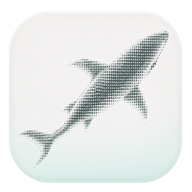
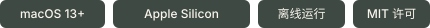
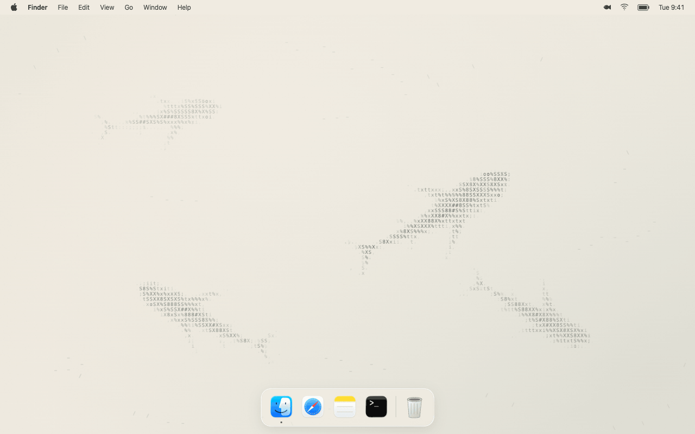
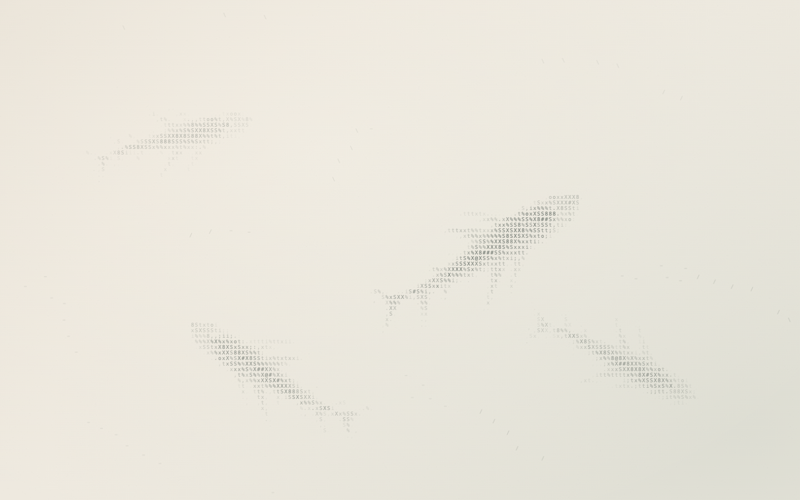
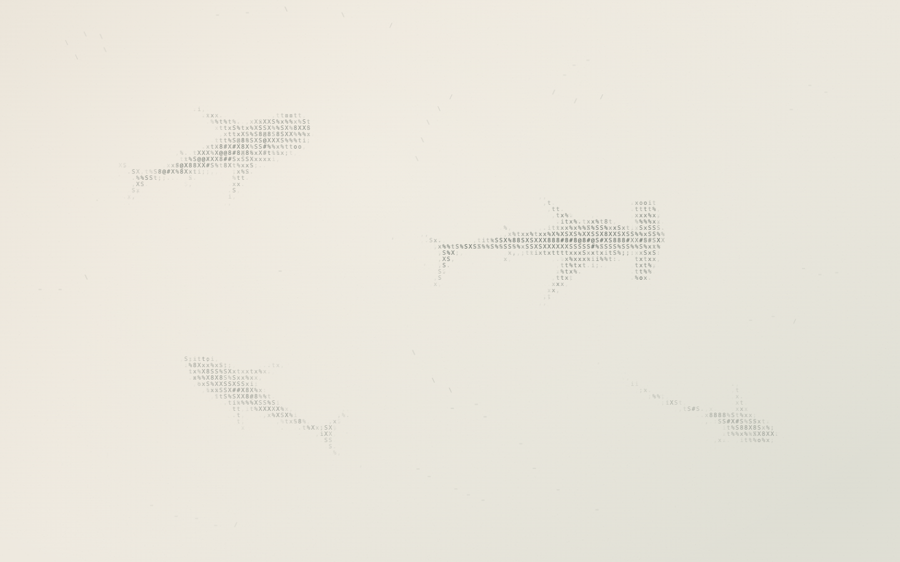
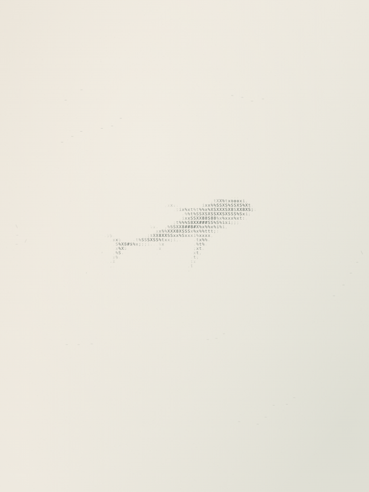

<p align="center">
  
</p>

<h1 align="center">ASCII Sharks Wallpaper</h1>

<p align="center">
  <strong>用字符，画一片安静的海。</strong><br>
  为 macOS 桌面添一点游动的墨色、一张温暖的纸，和恰到好处的留白。
</p>

<p align="center">
  
</p>

<p align="center">
  <a href="README.md">English</a> · <strong>简体中文</strong>
</p>

<p align="center">
  <a href="https://github.com/s1egg/ascii-sharks-wallpaper/releases/latest"><strong>下载 Mac 版</strong></a> ·
  <a href="#get-started">安装说明</a> ·
  <a href="#scenes">场景预览</a> ·
  <a href="#development">参与开发</a> ·
  <a href="#faq">常见问题</a>
</p>



<p align="center"><sub>使用应用实际渲染器制作的 10 秒 Remotion 桌面演示，桌面界面为示意。每一条鲨鱼、每一群小鱼、每一道尾流，都由字符绘成。<a href="docs/assets/macos-desktop.mp4">观看视频</a> · <a href="docs/assets/scene-classic.png">查看静态画面</a>。</sub></p>

<p align="center">免费开源 · 无需账号 · 无统计追踪<br>
喜欢这片小小的海？欢迎<a href="https://github.com/s1egg/ascii-sharks-wallpaper">点个 Star</a>，也欢迎在 <a href="https://github.com/s1egg/ascii-sharks-wallpaper/issues">Issues</a> 分享你的想法。</p>

<a name="features"></a>

## 让桌面安静一点

从中国水墨画的浓淡与留白中取意，把一片小小的海洋模拟变成安静的桌面背景。鲨鱼在温暖的纸面上滑行，鱼群聚拢、散开，又重新找到彼此。

本项目基于 [stackedlol/ascii-sharks](https://github.com/stackedlol/ascii-sharks) 改编，新增水墨渲染、推进与滑行交替的游动节奏，以及 macOS 原生桌面适配。

- **字符也有远近。** 用字形密度、墨色透明度与柔和过渡描绘轮廓，所有鱼类均由 Canvas 实时绘制。
- **慢慢游，自在停。** 头肩稳定、尾部自然摆动，转弯舒缓，每条鲨鱼都有独立的推进与滑行节奏。
- **认得出它的性格。** 在“混合物种”中，锤头鲨偏爱横向巡视，灰鲭鲨偶尔短促加速，长尾鲨则以更慢的摆尾舒缓转身。
- **偶然抬眼，有一点发现。** 偶尔有现有的小鱼群穿过留白，或一条淡墨的少见物种从远处经过。事件低频出现，随画面一起暂停。
- **留白多一点。** 小鱼以最多七条的松散小群游动，墨色更淡、间距更宽，让鲨鱼成为画面主体；鼠标靠近时，小鱼才稍稍清晰起来。
- **一点回应，一点好奇。** 鼠标经过时，附近鱼群散开；碰到小鱼才产生字符涟漪，空白水面保持安静。在经过的鲨鱼附近停留约 0.6 秒，可能引来一条转身、短暂加速靠近，再缓缓减速。默认开启，可在菜单中关闭“鼠标轻互动”。
- **自然融入 Mac。** Swift 原生菜单栏应用，壁纸位于桌面图标下方，鼠标点击可以穿透，键盘焦点留给手头的工作。
- **懂得适时休息。** 暂停和隐藏时停止动画调度；低电量模式或系统高温时，帧率上限降至 15 FPS 并降低分辨率；遵循系统“减少动态效果”设置。
- **按自己的节奏。** 三种场景、三档帧率、三档速度，可选择全部显示器或仅主屏幕，偏好设置会保留到下次启动。
- **选择熟悉的语言。** 默认英文，可即时切换为简体中文；切换时保留动画进度和已保存的偏好。
- **完全离线。** 使用本地资源、系统字体与本地 WKWebView，无账号、无统计追踪、无网络请求，运行时无需下载依赖。

<a name="scenes"></a>

## 三种游弋方式

<table>
  <tr>
    <td width="33%" align="center">
      <a href="docs/assets/scene-classic.png"></a><br>
      <strong>经典鲨群</strong><br>
      <sub>四道熟悉的身影，几层浓淡相宜的墨。</sub>
    </td>
    <td width="33%" align="center">
      <a href="docs/assets/scene-mixed.png"></a><br>
      <strong>混合物种</strong><br>
      <sub>锤头鲨、虎鲨、灰鲭鲨与长尾鲨。</sub>
    </td>
    <td width="33%" align="center">
      <a href="docs/assets/scene-solo.png"></a><br>
      <strong>独游</strong><br>
      <sub>一条鲨鱼，几群小鱼，多一点留白。</sub>
    </td>
  </tr>
</table>

<a name="get-started"></a>

## 开始使用

**需要 Apple Silicon（M 系列）Mac，系统为 macOS 13 或更新版本。** 应用默认使用英文，安装器说明为英文。在应用菜单中选择 **Language → 简体中文** 即可切换，自动保存，无需重启。

### 下载并安装

1. 打开[最新发布页](https://github.com/s1egg/ascii-sharks-wallpaper/releases/latest)，下载 **arm64 ZIP 压缩包**。
2. 解压后，将 **ASCII Sharks Wallpaper.app** 拖入**“应用程序”**文件夹。
3. 打开应用，点击**菜单栏的鱼形图标**，即可切换场景、调整速度或暂停动画。应用没有 Dock 图标或常驻主窗口。

也可以在同一发布页下载 **PKG 安装包**，安装到 `/Applications`。安装包不运行安装脚本，也不会自动启动应用。如果旧版仍在运行，请先从菜单栏鱼形图标中退出，再打开新版。

使用下载好的应用无需安装 Xcode、Bun 等开发工具。如果希望自行编译，请参阅[从源码构建](#build-from-source)。

> **分发状态：** 应用使用本地 ad hoc 签名，尚未配置 Developer ID 签名及 Apple 公证。复制到其他 Mac 后，系统可能提示确认应用来源。

<a name="controls"></a>

## 一枚菜单，刚好够用

点击菜单栏的鱼形图标。菜单按播放控制、场景与性能、显示器与语言、应用操作分组，顶部状态行说明壁纸当前的运行状态。下表使用切换到简体中文后的名称：

| 菜单选项 | 功能 | 可选值 / 默认值 |
| --- | --- | --- |
| `暂停动画` / `继续动画` | 控制动画播放 | 首次启动时自动播放。 |
| `隐藏壁纸` / `显示壁纸` | 显示或隐藏壁纸 | 默认显示。 |
| `海洋场景` | 选择场景 | 经典鲨群 · 混合物种 · 独游；默认**经典鲨群**。 |
| `鼠标轻互动` | 移动鼠标拨开鱼群，停留吸引经过的鲨鱼 | 默认**开启**；桌面点击仍可穿透。 |
| `帧率` | 设置帧率上限 | 15 / **30** / 60 FPS，分别标注节能 / 均衡 / 流畅。 |
| `游动速度` | 调整游动速度 | 0.5× / **1×** / 1.5×。 |
| `显示器` | 选择显示范围 | **所有显示器** / 仅主显示器。 |
| `语言` | 切换应用语言 | **English** / 简体中文；自动保存。 |
| `重新加载壁纸` | 重新载入本地渲染器 | 可用于处理渲染错误。 |
| `退出 ASCII Sharks Wallpaper` | 关闭应用 | 露出当前的系统壁纸。 |

隐藏、加载中、加载失败、系统暂停或启用“减少动态效果”时，播放控制暂不可用，状态行与提示会说明原因。节能模式保留所选的帧率偏好，并单独提示当前最高 15 FPS 的限制。

应用还监听系统睡眠、显示器休眠和会话切换，以暂停或恢复动画。锁屏检测使用 macOS 分布式通知补充，真实锁屏与唤醒行为仍需在各目标环境中验证。

<a name="development"></a>

## 小而清晰的实现

**Swift / AppKit → 本地 WKWebView → TypeScript / Canvas 2D。** Bun 将动画编译为单个浏览器脚本。原生层负责菜单、桌面窗口、偏好设置和系统事件，网页层负责模拟与绘制。

<a name="build-from-source"></a>

### 从源码构建

安装带有 **Swift 6** 编译器的 [Xcode Command Line Tools](https://developer.apple.com/xcode/resources/) 和 [Bun](https://bun.com/docs/installation)。已记录的构建环境使用 Swift 6.2.4 与 Bun 1.4.2。macOS 13 是应用的最低运行目标；用于构建的系统还需满足 Swift 工具链要求。

在项目根目录执行：

```sh
bash scripts/build.sh
open "dist/ASCII Sharks Wallpaper.app"
```

无需安装 npm 依赖。工具链准备好后，构建过程不需要下载第三方包。Bun 仅用于开发，构建好的应用可以独立运行。

构建会在 `dist/` 中生成应用和 arm64 ZIP 压缩包。需要 PKG 安装包时执行：

```sh
bash scripts/package.sh
```

打包脚本会构建应用、校验安装包内容及应用签名，并生成配套的 `.pkg.sha256` 校验文件。已有构建可用 `bash scripts/package.sh --skip-build` 直接打包。

需要完整的本地发布包时，先提交源码，再运行 `bun run release`。命令会验证干净的 commit，将 ZIP、安装器、中英文更新说明、校验和及 commit／构建记录整理到 `dist/releases/<version>/`。详见[发布流程](docs/RELEASING.md)、[更新日志](CHANGELOG.md)和 [0.1.2 更新说明](docs/releases/0.1.2.zh-CN.md)。

### 源码导览

| 路径 | 职责 |
| --- | --- |
| [`Sources/`](Sources/) | 原生应用生命周期、设置、系统事件监听及桌面窗口。 |
| [`Resources/`](Resources/) | 英文与简体中文的菜单、状态和提示框文案。 |
| [`Web/src/world.ts`](Web/src/world.ts) | 鱼群行为、鲨鱼导航与关节骨架。 |
| [`Web/src/motion.ts`](Web/src/motion.ts) · [`shapes.ts`](Web/src/shapes.ts) | 游动形变与物种轮廓。 |
| [`Web/src/renderer.ts`](Web/src/renderer.ts) | 字符绘制、宣纸纹理、墨色和尾流。 |
| [`Web/src/engine.ts`](Web/src/engine.ts) · [`wallpaper.ts`](Web/src/wallpaper.ts) | 固定时间步模拟、帧调度与原生桥接。 |
| [`Web/wallpaper.css`](Web/wallpaper.css) | 网页共享色板与 Canvas 样式。 |
| [`Tests/`](Tests/) | 模拟检查与真实 WKWebView 冒烟测试。 |
| [`scripts/`](scripts/) | 应用构建、图标生成、测试与 macOS 安装包。 |
| [`media/readme/`](media/readme/) | 可复现的 Remotion 桌面演示，依赖与应用构建相互独立。 |

### 运行检查

```sh
# Simulation checks only
bun run test:web

# Simulation checks, app build, and native WebKit smoke checks
bash scripts/test.sh
```

模拟测试覆盖头部稳定性、全部八种鲨鱼形态的关节长度、长时间游动、独游可见性、窗口缩放、指针避让、水痕数量与消退，以及单条鲨鱼的短暂好奇行为。原生测试验证资源加载、动画推进、暂停恢复、帧率设置、场景切换、隐藏、桌面窗口属性、语言与互动偏好保存、原生指针桥接、显示器坐标转换、菜单动作和无障碍描述的即时切换。测试会短暂打开一个窗口，结果保存到 `build/native-smoke-report.json`，截图保存到 `build/native-preview.png`。

<details>
<summary>终端无法访问 macOS 图形服务时</summary>

先生成测试应用，再在已登录的桌面会话中启动：

```sh
bash scripts/test.sh --prepare
open build/NativeSmoke.app
```

也可以在 Finder 中打开 `build/NativeSmoke.app`。检查完成后测试程序自动退出，结果请查看 `build/native-smoke-report.json`。

</details>

### 参与贡献与翻译

调整画面前，请先阅读[设计约定](DESIGN.md)。保留字符构成的轮廓、舒缓的动态与原生桌面行为。视觉改动请附截图或短录像，提交 Pull Request 前运行与改动相关的检查。

Swift、TypeScript、JavaScript、Shell、HTML、CSS 及嵌入脚本中的**代码注释与内部文档统一使用英文**。面向用户的界面文字与代码注释分别维护。[本地化维护指南](docs/LOCALIZATION.md)说明了资源文件、回退规则及新增应用语言的步骤。

[`README.md`](README.md) 为英文入口，[`README.zh-CN.md`](README.zh-CN.md) 为完整简体中文版。功能、命令、系统要求或限制变化时，请同步更新两份文档。新增语言时，使用 `README.<locale>.md` 命名，复用 `docs/assets/` 图片，保留具名章节锚点，并在所有 README 中补充语言切换链接。各语言代码示例中的注释也统一使用英文。

<a name="faq"></a>

## 你可能还想知道

<details>
<summary><strong>为什么画面不动？</strong></summary>

先检查顶部状态行与菜单中的“Pause Animation / Resume Animation”（中文为“暂停动画 / 继续动画”）。系统开启“减少动态效果”时，应用会按设定保持静态；壁纸被隐藏或当前会话不活跃时，也会暂停。低电量模式只降低帧率上限，不改变所选的游动速度。

</details>

<details>
<summary><strong>它会替换我的系统壁纸吗？</strong></summary>

应用将自己的窗口绘制在系统背景之上、桌面图标之下。隐藏或退出后，会露出当前选择的系统壁纸。卸载时先退出应用，再从“应用程序”移到废纸篓。

如果透明菜单栏比画面更暗，可能是 macOS 正在从底层系统壁纸取色。[`Assets/Backdrop/`](Assets/Backdrop/) 提供可选的同色背景。应用这些图片需要手动修改系统设置；退出应用不会撤销这项选择。

</details>

<details>
<summary><strong>哪些系统已经测试过？</strong></summary>

[验证记录](docs/VALIDATION.md)记载了 Apple Silicon、macOS 26.5.2 环境下通过的构建与原生 WebKit 检查。最低部署版本为 macOS 13.0；较早 macOS、其他 M 系列设备、多屏热插拔、Spaces、Stage Manager 和真实睡眠 / 锁屏恢复，仍需在目标环境验收。性能随分辨率和屏幕数量变化，不承诺固定功耗。

</details>

<details>
<summary><strong>当前有哪些功能尚未提供？</strong></summary>

这是一个早期 macOS 应用，可以下载发布版本或自行构建。目前不提供 Intel Mac 构建、登录启动、锁屏壁纸、壁纸商店、点击投食或自动更新。

</details>

<a name="credits"></a>

## 致谢与许可

基于 [stackedlol/ascii-sharks](https://github.com/stackedlol/ascii-sharks) 改编，感谢原作者创造的 ASCII 海洋。改编源码固定于上游提交 [`a0074c1`](https://github.com/stackedlol/ascii-sharks/tree/a0074c16a106f0abc665fe9712ca445f8f98ad8e)。

本项目采用 [MIT 许可](LICENSE)。来源与上游许可见[第三方声明](THIRD_PARTY_NOTICES.md)，应用图标来源见[图标说明](Assets/README.md)。这些补充文档统一使用英文维护。

---

<p align="center"><sub>一点墨色，一点游动，一张更安静的桌面。</sub></p>
